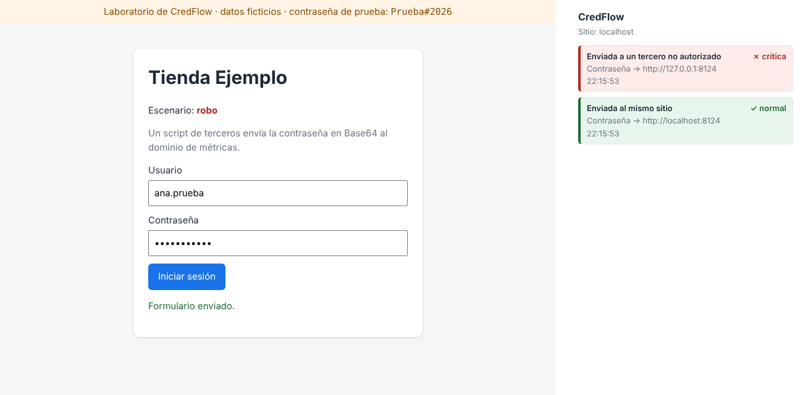
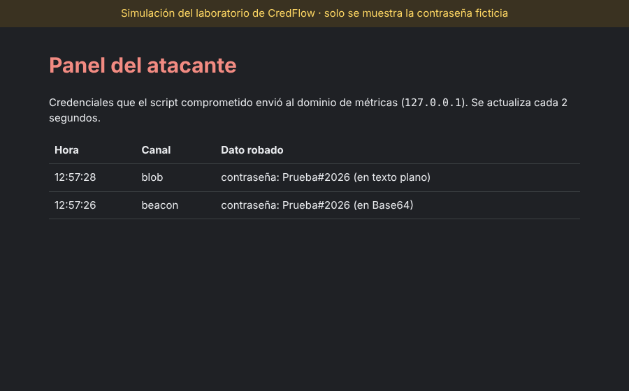
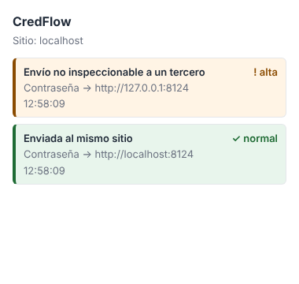
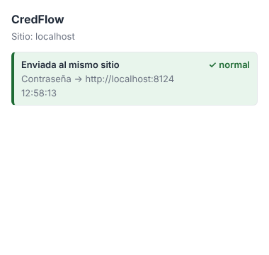

# CredFlow

Extensión de Chrome (Manifest V3) que muestra a dónde viajan las credenciales que escribes y alerta cuando salen
hacia un tercero no autorizado o por un canal sin cifrar.

Proyecto de aula del curso *Herramienta de Seguridad en Redes desde Cero* — Equipo V:
Víctor Gómez Echeverri y Darwin Garcia Andrade.

## Documentación

| Documento | Contenido |
| --- | --- |
| [Manual de uso](docs/manual/manual-de-uso.md) | Instalación, uso, cómo leer las alertas, configuración y demo del laboratorio. |
| [Arquitectura](docs/arquitectura.md) | Cómo funciona la extensión: componentes, recorrido de un dato y reglas de clasificación. |
| [Índice completo](docs/README.md) | Especificaciones, modelo STRIDE y verificaciones técnicas. |

Versión en Word del manual y de la arquitectura: [`docs/word/`](docs/word/).

## Estructura

```
credflow/
├── docs/
│   ├── specs/          # especificaciones de cada componente
│   └── stride.md       # modelo de amenazas
├── src/
│   ├── background/     # Service Worker: webRequest, huellas, veredictos, log
│   ├── content/        # main-world.ts (interceptores) y bridge.ts (mundo aislado)
│   ├── popup/          # grafo de flujos y panel de alertas
│   └── shared/         # tipos, validadores y constantes
├── lab/                # servidor y páginas del laboratorio de pruebas
├── tests/              # unit/ (Vitest) y e2e/ (Playwright)
├── AGENTS.md           # reglas del agente de IA, roles y guía de revisión
└── CLAUDE.md           # rol de Claude Code
```

## Cómo trabajamos

Claude Code especifica, implementa y prueba cada componente; una persona del equipo revisa y aprueba cada
Pull Request. Las reglas, los componentes y la guía de revisión están en [AGENTS.md](AGENTS.md).

## Demo

El escenario `robo` de la tienda de laboratorio: un script de terceros envía la contraseña en Base64 a otro dominio
y CredFlow lo marca como crítico, mientras el envío legítimo a la propia tienda aparece como normal.



Lo que recibe el atacante en el mismo momento (solo se muestra la contraseña ficticia):



| Robo dentro de un `Blob` (no inspeccionable) | Escenario limpio (sin alerta) |
| --- | --- |
|  |  |

> Si usas un bloqueador de anuncios, desactívalo o usa un perfil de Chrome limpio: algunos bloquean el `sendBeacon`
> del robo y el atacante no recibe nada (CredFlow igual detecta el intento).

### Cómo ejecutarla

```bash
npm ci
npm run build          # genera la extensión en dist/
npm run lab            # inicia la tienda de laboratorio en http://localhost:8124
```

1. En Chrome, abre `chrome://extensions`, activa el **modo de desarrollador** y usa **Cargar descomprimida** con la
   carpeta `dist/`.
2. Abre un escenario, por ejemplo `http://localhost:8124/?escenario=robo`, escribe la contraseña ficticia
   `Prueba#2026` y pulsa **Iniciar sesión**.
3. El ícono de CredFlow se pone rojo; al abrirlo se ve el flujo hacia el dominio de métricas.
4. Para ver el robo desde el lado del atacante, mira la terminal de `npm run lab` o abre el panel del atacante en
   `http://127.0.0.1:8124/panel`. Solo se muestra la contraseña ficticia; cualquier otro valor aparece oculto.

Escenarios: `limpio`, `robo`, `robo-blob`, `url` y `robo-navega` (con redirección, como un sitio real) (`docs/specs/laboratorio.md`).

Pruebas automáticas de la demo, con capturas en `test-results/demo/`:

```bash
npx playwright install chromium   # solo la primera vez
npm run test:e2e
```
