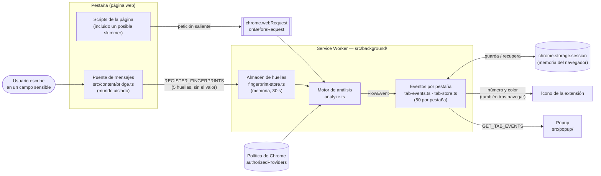

# Arquitectura de CredFlow

Este documento explica cómo funciona por dentro la extensión CredFlow (versión 0.1.0). El detalle de cada componente
está en su especificación en [`specs/`](specs/); aquí se explica cómo encajan.

## 1. Problema que resuelve

En un ataque tipo **Magecart**, un script de terceros comprometido (analítica, chat, publicidad) lee lo que el usuario
escribe en el formulario de pago o de inicio de sesión y lo envía a un servidor del atacante. La página se ve normal
y el usuario no nota nada.

CredFlow es una extensión de Chrome (Manifest V3) que **sigue los datos sensibles que el usuario escribe** y avisa
cuando salen de la página hacia:

- un **tercero no autorizado** (otro sitio distinto del que el usuario está visitando), o
- un **canal sin cifrar** (`http:` o `ws:`).

Para eso usa lo que el navegador le deja ver a una extensión: las peticiones HTTP que salen de cada pestaña.

## 2. Idea central: huellas

CredFlow no guarda la contraseña ni el número de tarjeta. Cuando el usuario escribe en un campo sensible, el content
script calcula **huellas** del valor: el mismo texto en las codificaciones que suele usar un script malicioso para
disimularlo.

| Codificación | Ejemplo para `Prueba#2026` |
| --- | --- |
| `original` | `Prueba#2026` |
| `base64` | `UHJ1ZWJhIzIwMjY=` |
| `url` | `Prueba%232026` |
| `hex` | `5072756562612332303236` |
| `reversed` | `6202#abeurP` |

El Service Worker busca esas huellas en el cuerpo y en la URL de cada petición que sale de la pestaña. Las huellas
**solo viven en memoria durante 30 segundos** y nunca se guardan, se registran ni se muestran.

## 3. Componentes



| # | Componente | Dónde | Qué hace |
| --- | --- | --- | --- |
| 1 | **Puente de mensajes** | `src/content/bridge.ts`, `fields.ts` | Content script en el **mundo aislado**, en todos los marcos, desde `document_start`. Detecta escritura real en campos sensibles y envía las huellas al Service Worker. |
| 2 | **Motor de análisis** | `src/background/analyze.ts`, `fingerprint-store.ts`, `request-body.ts`, `site.ts` | Guarda las huellas en memoria, lee cada petición saliente con `chrome.webRequest`, busca las huellas y clasifica el flujo. |
| 3 | **Eventos y alertas** | `src/background/tab-events.ts`, `tab-store.ts`, `flow-events.ts` | Guarda los últimos 50 eventos y el resumen de alertas de cada pestaña, en memoria y en `chrome.storage.session`. Actualiza el número y el color del ícono, y lo vuelve a aplicar cuando la pestaña termina de cargar otra página. |
| 4 | **Popup** | `src/popup/` | Muestra los flujos de la pestaña activa (veredicto, tipo de campo, destino y hora) y una sección plegable de ayuda, "Cómo probar CredFlow". |
| 5 | **Configuración administrada** | `src/background/managed-config.ts`, `public/managed-schema.json` | Lee la lista de proveedores de inicio de sesión autorizados desde la política de Chrome. |

Código compartido entre componentes (`src/shared/`):

| Archivo | Contenido |
| --- | --- |
| `types.ts` | Contratos: `RegisterFingerprints`, `FlowEvent`, `DiagnosticEvent`, `GetTabEvents`, `TabEventsResponse`. |
| `validators.ts` | Validación estricta de todo mensaje que llega de una página o del popup. |
| `fingerprints.ts` | Cálculo de las 5 huellas. Lo usan el Puente (que las genera) y las pruebas del Motor. |
| `constants.ts` | Límites: 30 s de vida, huellas de 6 a 1024 caracteres, 256 KiB de cuerpo analizado, umbral de errores. |

## 4. Recorrido de un dato sensible

1. **El usuario escribe** en un campo `type="password"` o con `autocomplete` que contiene `cc-number` o `cc-csc`.
   Solo cuentan los eventos de teclado reales (`event.isTrusted`): un script de la página no puede inyectar valores.
2. **El Puente envía las huellas** 300 ms después de la última tecla, o de inmediato al salir del campo (`blur`),
   al pulsar Enter o al enviar el formulario. Si el valor tiene menos de 6 caracteres, no envía nada.
   Además, ante un **clic de confianza** en cualquier parte de la página (`pointerdown` en fase de captura), vuelve a
   enviar las huellas de los campos donde el usuario escribió si su último envío fue hace más de **10 s**. Como
   `pointerdown` ocurre antes del `click` que procesa la página, el Motor tiene huellas vigentes aunque un botón envíe
   el dato por JavaScript mucho después de escribirlo. Por campo solo se guarda la hora del último envío, nunca el valor.
3. **El Service Worker valida el mensaje** (remitente = esta extensión y una pestaña real; exactamente los campos
   esperados; tipos y longitudes correctos) y guarda las huellas de esa pestaña durante 30 s. Un registro nuevo del
   mismo tipo de campo reemplaza al anterior.
4. **Cada petición saliente de la pestaña** pasa por `webRequest.onBeforeRequest`. El Motor lee hasta 256 KiB del
   cuerpo y busca las huellas en el cuerpo y luego en la URL (también decodificada).
5. **Clasifica** el flujo (sección 5) y produce un `FlowEvent`, que nunca contiene el valor, la huella, la ruta ni la
   consulta de la URL: solo el origen de destino, los sitios, el método, el tipo de campo, la codificación y el veredicto.
6. **Registro por pestaña:** el evento se guarda en la lista de la pestaña (máximo 50; al llenarse se descarta el más
   antiguo, pero el contador de alertas no baja) y se copia en `chrome.storage.session`.
7. **Alerta:** si la severidad es crítica o alta, el ícono de esa pestaña muestra el número de alertas (rojo si hay
   alguna crítica, ámbar si solo hay altas). El popup lista los flujos.

### 4.1. Persistencia de las alertas

Chrome detiene el Service Worker de una extensión tras unos 30 s sin actividad, y con él se pierde lo que tenía en
memoria. Para que el popup no se quede vacío, los eventos de cada pestaña se guardan también en
`chrome.storage.session` con la clave `tab:<tabId>`:

- `storage.session` vive en la **memoria del navegador**: no se escribe en disco y se borra al cerrar Chrome.
- Con su nivel de acceso predeterminado, los content scripts no pueden leerlo.
- Solo contiene `FlowEvent` y el resumen de alertas, que por contrato no tienen valores, huellas, rutas ni consultas.
- Lo leído se valida antes de usarse (`parseStoredTabState`); si no tiene la forma esperada, se descarta.
- Las lecturas y escrituras se hacen en orden (una cola), para que dos eventos seguidos no se pisen.
- Al cerrar la pestaña se borra su clave.

Las **huellas no se guardan ahí**: siguen solo en la memoria del Service Worker, con su caducidad de 30 s.

### 4.2. El ícono tras navegar

Chrome borra el número del ícono de una pestaña cuando esta navega a otra página, algo habitual justo después de
iniciar sesión. Por eso, cada vez que una pestaña termina de cargar (`chrome.tabs.onUpdated` con
`status: "complete"`), el ícono se vuelve a aplicar desde el resumen guardado. Ese evento no requiere el permiso
`tabs`, porque solo se usan el `tabId` y el estado.

## 5. Clasificación de los flujos

El "sitio" de una URL es su **eTLD+1** (dominio registrable), calculado con la librería `tldts`. Por ejemplo,
`login.tienda.com` y `www.tienda.com` son el mismo sitio (`tienda.com`).

Se evalúa en orden; gana la primera regla que aplique:

| # | Condición | Veredicto | Severidad |
| --- | --- | --- | --- |
| 1 | Esquema `http:` o `ws:` hacia un host que no es de bucle local | `insecure_channel` | Crítica |
| 2 | El sitio de destino es distinto del de la página y no está autorizado | `third_party` | Crítica |
| 3 | La huella apareció en la URL | `credential_in_url` | Alta |
| 4 | El destino es un proveedor autorizado | `authorized_provider` | Sin alerta |
| 5 | El destino es el mismo sitio | `same_site` | Sin alerta |

Caso especial, **cuerpo no inspeccionable** (`opaque_body`, severidad alta): Chrome no le entrega a la extensión el
contenido de los cuerpos `Blob`, `File` ni `ReadableStream`. Si la pestaña tiene huellas activas y envía un cuerpo
de ese tipo a un tercero, CredFlow alerta aunque no pueda confirmar el dato. Así, envolver la contraseña en un `Blob`
no sirve para evadir la detección.

Hosts de bucle local (`localhost`, `*.localhost`, `127.0.0.0/8`, `[::1]`): no cuentan como canal sin cifrar, porque
ese tráfico no sale del equipo. Esto permite el laboratorio en `http://localhost`.

## 6. Contratos entre componentes

**Puente → Service Worker** (`RegisterFingerprints`):

```ts
{ kind: "REGISTER_FINGERPRINTS", fieldType: "password" | "card" | "custom", fingerprints: Fingerprint[] }
```

1 a 5 huellas, sin codificaciones repetidas, cada una de 6 a 1024 caracteres. El `tabId` no viaja en el mensaje:
el Service Worker lo toma de `sender.tab.id`, que la página no puede falsificar.

**Popup → Service Worker** (`GetTabEvents`):

```ts
{ kind: "GET_TAB_EVENTS", tabId: number }  →  { events: FlowEvent[] }
```

Solo se responde si el remitente es una página de la propia extensión (`sender.url` empieza por
`chrome-extension://<id>/`). Un content script no puede pedir los eventos de otras pestañas.

**Salida del Motor** (`FlowEvent`): `id`, `timestamp` (UTC), `tabId`, `pageSite`, `destinationOrigin`,
`destinationSite`, `method`, `requestType`, `fieldType`, `encoding`, `location` (`body` o `url`), `truncated`,
`verdict` y `severity`.

**Diagnóstico** (`DiagnosticEvent`): si hay 5 errores de análisis en 60 s, el Motor publica un evento con el número
de errores, sin ningún dato de lo que falló. Así, una página que provoque errores a propósito para evadir el
análisis no pasa desapercibida.

## 7. Seguridad de la propia extensión

CredFlow ve credenciales y tiene acceso a todos los sitios, así que **la propia extensión es el activo más sensible**.
El modelo completo está en [stride.md](stride.md). Controles principales en el código actual:

| Control | Cómo se cumple |
| --- | --- |
| No persistir datos sensibles | Huellas solo en memoria con un temporizador de 30 s. En `chrome.storage.session` solo van `FlowEvent`, sin valores, huellas, rutas ni consultas, y nada se escribe en disco. |
| No mostrar datos sensibles | El popup muestra "Contraseña" o "Tarjeta", nunca el valor. |
| No inyectar HTML | Todo el texto del popup se inserta con `textContent`. ESLint con `eslint-plugin-no-unsanitized` lo comprueba. |
| Sin código remoto | CSP `script-src 'self'; object-src 'none'; base-uri 'none'`. Sin `eval` ni `new Function`. |
| Sin conexiones salientes | La extensión no hace `fetch` a ningún servidor. |
| Entrada no confiable | Todo mensaje se valida con esquema estricto (`validators.ts`) y se comprueba el remitente. |
| Escritura real | El Puente ignora eventos sintéticos y solo envía campos donde el usuario escribió con el teclado. |
| Permisos mínimos | `webRequest`, `storage` y `host_permissions: <all_urls>`. Nada más. |
| Errores genéricos | Los fallos se capturan, no detienen el análisis y el popup solo muestra "No se pudo cargar la información". |
| Mínimo código de terceros | Una sola librería dentro de la extensión (`tldts`), con versión fijada. |

## 8. Limitaciones conocidas

- **Sin historial permanente:** las alertas sobreviven a los reinicios del Service Worker, pero se pierden al cerrar
  la pestaña o el navegador.
- **Ventana de 30 s:** las huellas se renuevan al escribir, al enviar y con cada clic del usuario. Si un script guarda
  la contraseña y la envía más de 30 s después sin ninguna interacción del usuario, no se detecta.
- **Codificaciones:** solo se reconocen las cinco de la sección 2. Un cifrado propio del atacante no se detecta,
  salvo que vaya en un cuerpo opaco a un tercero.
- **Cuerpos grandes:** solo se analizan los primeros 256 KiB de cada petición (el evento lo marca con `truncated`).
- **Campos sensibles:** solo contraseñas y tarjetas (número y código de seguridad). Otros campos (`custom`) están
  previstos en el contrato pero no se detectan todavía.
- **Sin atribución:** CredFlow sabe a dónde fue el dato, pero no qué script de la página lo envió.
- **Solo detecta:** no bloquea el envío.
