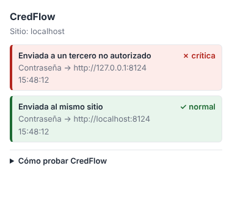
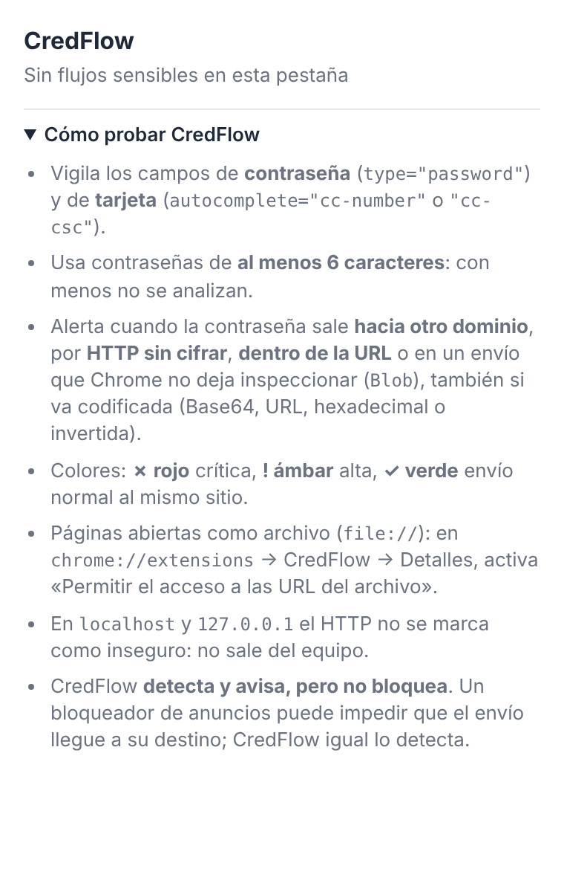
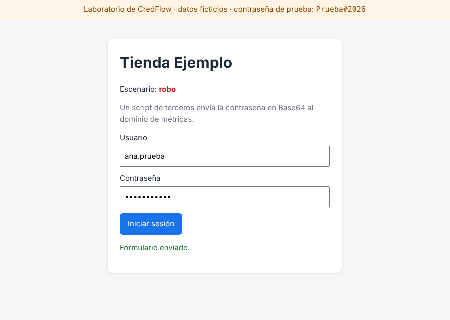
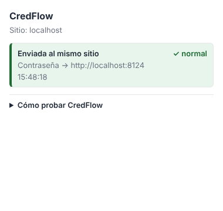
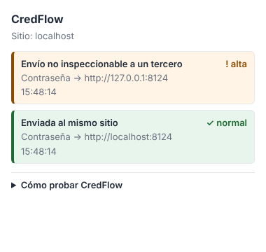
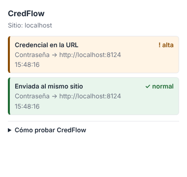
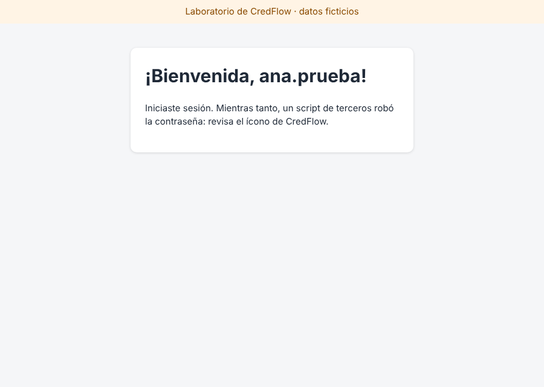
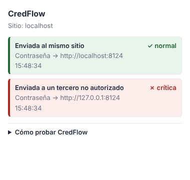
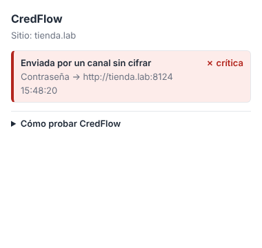

# Manual de uso de CredFlow

Versión 0.1.0

## Contenido

1. [Qué es CredFlow](#1-qué-es-credflow)
2. [Requisitos](#2-requisitos)
3. [Instalación](#3-instalación)
4. [Uso diario](#4-uso-diario)
5. [Cómo leer las alertas](#5-cómo-leer-las-alertas)
6. [Demo con el laboratorio](#6-demo-con-el-laboratorio)
7. [Configuración: proveedores autorizados](#7-configuración-proveedores-autorizados)
8. [Privacidad: qué guarda CredFlow y qué no](#8-privacidad-qué-guarda-credflow-y-qué-no)
9. [Limitaciones](#9-limitaciones)
10. [Solución de problemas](#10-solución-de-problemas)
11. [Glosario](#11-glosario)

---

## 1. Qué es CredFlow

CredFlow es una extensión de Google Chrome que **vigila a dónde viajan las contraseñas y los datos de tarjeta que
escribes** en una página web. Te avisa cuando uno de esos datos sale:

- hacia **otro sitio** distinto del que estás visitando (un tercero no autorizado), o
- por una **conexión sin cifrar** (`http://`), donde cualquiera en la red podría leerlo.

Está pensada para detectar ataques tipo **Magecart**: un script de terceros (analítica, publicidad, chat) que ha sido
comprometido copia lo que escribes en el formulario y lo envía a un servidor del atacante. La página se ve y funciona
normal, así que sin una herramienta como CredFlow no lo notarías.

CredFlow **no bloquea** el envío: lo detecta y te lo muestra para que decidas qué hacer.

## 2. Requisitos

| Requisito | Detalle |
| --- | --- |
| Navegador | Google Chrome o Chromium reciente (la extensión usa Manifest V3). |
| Sistema | Windows, macOS o Linux. |
| Para compilar | Node.js 24 LTS y npm. |
| Para la demo | El repositorio del proyecto (incluye el laboratorio). No necesita Internet. |

## 3. Instalación

CredFlow aún no está publicado en Chrome Web Store. Se instala como **extensión descomprimida** a partir del código.

### 3.1. Compilar la extensión

En una terminal, dentro de la carpeta del proyecto:

```bash
npm ci
```

```bash
npm run build
```

Se crea la carpeta `dist/` con la extensión lista para cargar.

> Si recibiste el ZIP de la demo con la carpeta `dist/` ya compilada, puedes saltarte este paso.

### 3.2. Cargar la extensión en Chrome

1. Abre `chrome://extensions` en la barra de direcciones.
2. Activa el **Modo de desarrollador** (interruptor arriba a la derecha).
3. Pulsa **Cargar descomprimida** y elige la carpeta `dist/`.
4. Aparece la tarjeta **CredFlow 0.1.0**. Comprueba que está activada.
5. Fija el ícono en la barra: pulsa el ícono de rompecabezas (Extensiones) y luego el alfiler junto a CredFlow.
6. **Opcional, para páginas abiertas como archivo** (`file://`): en la tarjeta de CredFlow pulsa **Detalles** y activa
   **Permitir el acceso a las URL del archivo**. Sin esto, Chrome no deja que CredFlow vigile esas páginas.

Al instalarla, Chrome avisa que la extensión puede "leer y cambiar todos tus datos en todos los sitios web".
CredFlow necesita ese acceso para ver las peticiones que salen de cada página; en la
[sección 8](#8-privacidad-qué-guarda-credflow-y-qué-no) se explica qué hace y qué no hace con él.

### 3.3. Actualizar o desinstalar

- **Actualizar:** vuelve a ejecutar `npm run build` y pulsa el botón de recargar (↻) en la tarjeta de CredFlow en
  `chrome://extensions`. Recarga también las pestañas que tenías abiertas.
- **Desinstalar:** pulsa **Quitar** en la tarjeta. CredFlow no deja datos guardados en el equipo.

## 4. Uso diario

CredFlow trabaja solo, en segundo plano. No hay que activarlo en cada página.

1. **Escribe normalmente** en un formulario. CredFlow presta atención a:
   - campos de **contraseña**, y
   - campos de **tarjeta** (número y código de seguridad), cuando la página los marca como tales.
2. Al enviar el formulario (o al salir del campo, o al pulsar Enter), CredFlow revisa durante **30 segundos** todas
   las peticiones que salen de esa pestaña buscando el dato, aunque vaya disfrazado (Base64, codificado en la URL, en
   hexadecimal o al revés). Si tardas en actuar, **cada clic que haces en la página renueva esa vigilancia** (cuando
   pasaron más de 10 segundos desde la última vez), así que un botón que envíe el dato por JavaScript minutos después
   también se detecta.
3. **Mira el ícono de CredFlow** en la barra:

| El ícono muestra | Significa |
| --- | --- |
| Sin número | No hay alertas en esta pestaña. |
| Número en **rojo** | Hay al menos una alerta **crítica**: el dato salió hacia un tercero o por un canal sin cifrar. |
| Número en **ámbar** | Hay alertas de severidad **alta**, pero ninguna crítica. |

El número cuenta las alertas de **esa pestaña** (máximo "99+"). Cada pestaña tiene su propio contador, que se
mantiene aunque la página cambie (por ejemplo, cuando el sitio te redirige después de iniciar sesión) y hasta que
cierres la pestaña.

4. **Pulsa el ícono** para abrir el popup con el detalle de los flujos de la pestaña activa.



El popup muestra, del más reciente al más antiguo:

- **Encabezado:** el sitio que estás visitando.
- **Una fila por flujo** con:
  - el **veredicto** (por ejemplo, "Enviada a un tercero no autorizado"),
  - la **severidad**, con color y símbolo (✗ crítica, ! alta, ✓ normal),
  - el **tipo de dato** ("Contraseña" o "Tarjeta"; nunca el valor),
  - el **destino** (protocolo, dominio y puerto; nunca la ruta ni los parámetros),
  - la **hora**.

Si no hubo envíos de datos sensibles, el popup dice "Sin flujos sensibles en esta pestaña".

Las alertas siguen ahí aunque Chrome pause la extensión en segundo plano (lo hace tras unos 30 segundos sin
actividad): puedes abrir el popup minutos después y verás lo mismo.

Al final del popup está la sección plegable **"Cómo probar CredFlow"**. Púlsala para ver un resumen rápido: qué
campos vigila, el mínimo de 6 caracteres, qué envíos detecta, qué significa cada color, cómo habilitar las páginas
`file://`, por qué en `localhost` el HTTP no se marca como inseguro y que CredFlow no bloquea.



## 5. Cómo leer las alertas

| Mensaje en el popup | Severidad | Qué pasó | Qué hacer |
| --- | --- | --- | --- |
| **Enviada a un tercero no autorizado** | ✗ Crítica | Tu dato salió hacia un sitio distinto del que visitas y que no está en la lista de proveedores autorizados. Es el patrón típico de un robo tipo Magecart. | No sigas usando el sitio. Cambia la contraseña (desde otro dispositivo o sitio de confianza). Si era una tarjeta, avisa a tu banco. Reporta el sitio. |
| **Enviada por un canal sin cifrar** | ✗ Crítica | El dato viajó por `http://` o `ws://`, sin cifrado. Cualquiera en tu red (por ejemplo, una red Wi-Fi pública) podría leerlo. | No envíes datos en ese sitio. Cambia la contraseña si ya la enviaste. |
| **Envío no inspeccionable a un tercero** | ! Alta | Justo después de que escribiste, la página envió a un tercero un contenido que Chrome no deja revisar (un archivo o bloque binario). CredFlow no puede confirmar que sea tu dato, pero es sospechoso. | Trátalo como posible robo. Revisa qué sitio es el destino; si no lo reconoces, actúa como en una alerta crítica. |
| **Credencial en la URL** | ! Alta | El dato apareció en la dirección (URL) de una petición, aunque vaya al mismo sitio. Las URL quedan en historiales, registros de servidores y cabeceras `Referer`. | Es una mala práctica del sitio. Evita reutilizar esa contraseña y repórtalo al responsable del sitio. |
| **Enviada a un proveedor autorizado** | ✓ Normal | El dato fue a un proveedor de inicio de sesión que tu organización autorizó (por ejemplo, `accounts.google.com`). | Nada. Es esperado. |
| **Enviada al mismo sitio** | ✓ Normal | El dato fue al mismo sitio que visitas, por un canal cifrado. Es lo que ocurre al iniciar sesión normalmente. | Nada. Es esperado. |

**¿Qué es "el mismo sitio"?** CredFlow compara el dominio registrable. `www.tienda.com`, `pagos.tienda.com` y
`tienda.com` son el mismo sitio; `tienda-metricas.com` es otro.

## 6. Demo con el laboratorio

El proyecto incluye una tienda de prueba que funciona en tu propio equipo, sin Internet, con un script de
"analítica" que roba la contraseña. Solo usa la **contraseña ficticia `Prueba#2026`**. Nunca escribas una
contraseña real en el laboratorio.

### 6.1. Iniciar el laboratorio

1. Compila y carga la extensión ([sección 3](#3-instalación)).
2. En una terminal, dentro del proyecto:

```bash
npm run lab
```

La terminal muestra las direcciones de cada escenario y queda esperando. Déjala abierta: ahí aparece lo que recibe
cada sitio. Para detener el laboratorio, pulsa `Ctrl+C`.

El laboratorio simula dos sitios distintos en el puerto 8124:

| Sitio | Dirección | Papel |
| --- | --- | --- |
| Tienda | `http://localhost:8124` | Sitio legítimo con el formulario |
| Métricas | `http://127.0.0.1:8124` | Servidor del atacante |

### 6.2. Recorrer un escenario

1. Abre `http://localhost:8124/?escenario=robo`.
2. Escribe un usuario cualquiera y la contraseña `Prueba#2026` **con el teclado** (no la pegues con un script).
3. Pulsa **Iniciar sesión**.



4. El ícono de CredFlow se pone **rojo con un 1**. Ábrelo: verás "Enviada a un tercero no autorizado" hacia
   `http://127.0.0.1:8124` y el envío normal a la tienda.
5. Mira la terminal de `npm run lab`: aparece la línea **ATACANTE** con la contraseña recibida en Base64.
6. También puedes abrir el **panel del atacante** en `http://127.0.0.1:8124/panel`, que se actualiza cada 2 segundos
   y muestra lo que "robó" el script. Por seguridad, solo muestra la contraseña ficticia; cualquier otro valor
   aparece oculto, y nada se guarda en disco.

> Si usas un bloqueador de anuncios, puede impedir que el envío del script llegue al servidor de métricas, y el
> atacante no recibirá nada. CredFlow igual detecta el intento. Para ver los dos lados de la demo, desactiva el
> bloqueador o usa un perfil de Chrome sin extensiones.

### 6.3. Escenarios

Cambia el valor de `?escenario=` en la dirección:

| Escenario | Dirección | Qué hace el script | Resultado esperado |
| --- | --- | --- | --- |
| `limpio` | `http://localhost:8124/?escenario=limpio` | Nada malicioso: el formulario se envía solo a la tienda. | ✓ "Enviada al mismo sitio", sin número en el ícono. |
| `robo` | `http://localhost:8124/?escenario=robo` | Envía la contraseña en Base64 al servidor de métricas. | ✗ "Enviada a un tercero no autorizado", ícono rojo. |
| `robo-blob` | `http://localhost:8124/?escenario=robo-blob` | Envía la contraseña dentro de un `Blob`, que Chrome no deja inspeccionar. | ! "Envío no inspeccionable a un tercero", ícono ámbar. |
| `url` | `http://localhost:8124/?escenario=url` | Envía la contraseña en la URL de una petición a la propia tienda. | ! "Credencial en la URL", ícono ámbar. |
| `robo-navega` | `http://localhost:8124/?escenario=robo-navega` | Como un sitio real: el script roba la contraseña y la tienda redirige a una página de bienvenida. | ✗ "Enviada a un tercero no autorizado"; el ícono **sigue en rojo** en la página de bienvenida. |

| `limpio` | `robo-blob` | `url` |
| --- | --- | --- |
|  |  |  |

En `robo-navega`, después de iniciar sesión la pestaña ya está en otra página, pero el popup conserva el robo:

| Página después de la redirección | Popup en esa página |
| --- | --- |
|  |  |

### 6.4. Escenario de canal sin cifrar (opcional)

El laboratorio usa `http://localhost`, que CredFlow no considera inseguro porque ese tráfico no sale del equipo.
Para ver la alerta de canal sin cifrar hace falta un nombre de host que no sea local:

1. Agrega esta línea al archivo `hosts` del sistema (requiere permisos de administrador):
   - Windows: `C:\Windows\System32\drivers\etc\hosts`
   - macOS y Linux: `/etc/hosts`

   ```
   127.0.0.1 tienda.lab
   ```

2. Abre `http://tienda.lab:8124/?escenario=limpio`, escribe la contraseña y envía el formulario.
3. Resultado: ✗ "Enviada por un canal sin cifrar", ícono rojo.



Al terminar, borra la línea del archivo `hosts`.

## 7. Configuración: proveedores autorizados

Algunos sitios envían la contraseña a otro dominio de forma legítima, por ejemplo cuando inician sesión con un
proveedor externo (`accounts.google.com`, `login.microsoftonline.com`). Para que esos envíos no generen alertas, un
administrador puede declarar una lista de **proveedores autorizados**.

La lista no se cambia desde el popup: se entrega como **política de Chrome**, para que un script de una página o un
usuario sin privilegios no pueda modificarla. Se llama `authorizedProviders` y es una lista de dominios. CredFlow
los compara por dominio registrable (autorizar `accounts.google.com` autoriza `google.com`) y descarta las entradas
que no sean nombres de dominio válidos. Se admiten hasta 200 entradas.

Necesitas el **ID de la extensión**, que aparece en su tarjeta en `chrome://extensions`. En una extensión
descomprimida, el ID depende de la carpeta desde la que se cargó.

> **Por verificar:** la configuración por política no está cubierta por las pruebas E2E. Las pruebas unitarias
> comprueban cómo CredFlow interpreta la lista (`managed-config.test.ts`). Después de configurarla, comprueba en
> `chrome://policy` que la política aparece bajo el ID de CredFlow.

**Linux.** Crea el archivo `/etc/opt/chrome/policies/managed/credflow.json` (en Chromium:
`/etc/chromium/policies/managed/credflow.json`), cambiando `<ID>` por el de la extensión:

```json
{
  "3rdparty": {
    "extensions": {
      "<ID>": {
        "authorizedProviders": ["accounts.google.com", "login.microsoftonline.com"]
      }
    }
  }
}
```

**Windows.** En el Registro, crea la clave
`HKEY_LOCAL_MACHINE\Software\Policies\Google\Chrome\3rdparty\extensions\<ID>\policy\authorizedProviders`
y dentro de ella un valor de cadena por dominio, con nombres `1`, `2`, `3`…

**macOS.** Se configura con un perfil de configuración (`.mobileconfig`) para el dominio `com.google.Chrome.extensions.<ID>`.

Los cambios se aplican sin reinstalar la extensión: CredFlow vuelve a leer la política cuando Chrome la actualiza.
En `chrome://policy` se puede pulsar **Volver a cargar políticas**.

## 8. Privacidad: qué guarda CredFlow y qué no

CredFlow necesita ver lo que escribes y las peticiones de todos los sitios, así que está diseñado para no convertirse
él mismo en un riesgo.

| CredFlow **sí** | CredFlow **no** |
| --- | --- |
| Calcula huellas del valor que escribes y las guarda **solo en memoria durante 30 segundos**. | Guarda tu contraseña, tu tarjeta ni sus huellas en disco, en `chrome.storage` ni en ningún otro lugar. |
| Guarda, por pestaña, los últimos 50 flujos y el número de alertas: tipo de dato, destino (dominio y puerto), veredicto y hora. Los guarda en la **memoria del navegador** (`chrome.storage.session`), para no perderlos cuando Chrome pausa la extensión. | Escribe esos flujos en disco. `chrome.storage.session` no se guarda en el disco y las páginas web no pueden leerlo. |
| De cada campo donde escribiste guarda solo la **hora** del último aviso, para saber cuándo renovar la vigilancia. | Muestra el valor de un dato en el popup, ni siquiera parcialmente. |
| Borra todo lo de una pestaña cuando la cierras. | Guarda la ruta ni los parámetros de las URL. |
| Lee la lista de proveedores autorizados de la política de Chrome. | Se conecta a ningún servidor. No hay telemetría ni reportes de errores. |
| | Ejecuta código descargado de Internet. |

Al cerrar Chrome se borra toda la información de CredFlow.

## 9. Limitaciones

Conviene saber qué **no** detecta CredFlow en esta versión:

- **Solo contraseñas y tarjetas.** Otros datos (documentos de identidad, correos, etc.) no se siguen.
- **Campos de tarjeta:** solo si la página los marca con `autocomplete="cc-number"` o `autocomplete="cc-csc"`.
  Si una tienda no marca sus campos, CredFlow no los reconoce.
- **Ventana de 30 segundos.** CredFlow vigila durante 30 segundos después de que escribes, envías o haces clic en la
  página. Si un script guarda el dato y lo envía más tarde por su cuenta, sin que hagas nada en la página, no se
  detecta.
- **Disfraces conocidos.** Se reconocen el valor original, Base64, codificación URL, hexadecimal e invertido.
  Un cifrado propio del atacante no se reconoce, salvo que lo envíe como contenido no inspeccionable a un tercero.
- **Contraseñas cortas.** Valores de menos de 6 caracteres no se siguen, para evitar falsas alarmas.
- **Cuerpos grandes.** Solo se revisan los primeros 256 KiB de cada petición.
- **Sin historial permanente.** Las alertas se conservan mientras la pestaña y Chrome sigan abiertos. Al cerrar la
  pestaña o el navegador, desaparecen; no hay un registro para consultar después.
- **Sin notificaciones.** La única señal es el ícono; no aparecen avisos del sistema.
- **No identifica el script culpable.** Indica a dónde fue el dato, pero no qué script de la página lo envió.
- **No bloquea.** CredFlow detecta y avisa; no impide el envío.

## 10. Solución de problemas

| Problema | Causa probable | Solución |
| --- | --- | --- |
| El popup dice "No se pudo cargar la información". | La extensión se recargó o la pestaña es una página interna de Chrome. | Recarga la pestaña y vuelve a abrir el popup. En páginas `chrome://` CredFlow no funciona. |
| Escribí la contraseña y el ícono no cambia. | El envío fue al mismo sitio (no es una alerta), la contraseña tiene menos de 6 caracteres, o la pestaña ya estaba abierta antes de instalar CredFlow. | Abre el popup para ver si hay un flujo "normal". Recarga la página después de instalar o actualizar la extensión. |
| No detecta nada en una página abierta como archivo (`file://`). | Chrome no deja a las extensiones entrar en archivos locales sin permiso. | En `chrome://extensions` → CredFlow → **Detalles**, activa **Permitir el acceso a las URL del archivo** y recarga la página. |
| CredFlow alertó, pero el panel del atacante no recibió nada. | Un bloqueador de anuncios detuvo el envío del script. | Es normal: CredFlow detecta el intento aunque no llegue. Desactiva el bloqueador si quieres ver el lado del atacante. |
| No aparece nada en el popup cuando el valor lo asigna un script (por ejemplo, una prueba automatizada que cambia el campo por código). | CredFlow solo sigue lo que el usuario escribe de verdad, para que una página no pueda engañarlo con valores falsos. | Escribe el valor con el teclado. |
| En el laboratorio todo sale como "Enviada por un canal sin cifrar". | Se está usando una versión antigua de la extensión. | Ejecuta `npm run build` y recarga la extensión. |
| `npm run lab` dice que no puede usar el puerto 8124. | Otro proceso (otra copia del laboratorio) usa el puerto. | Cierra la otra terminal o el proceso que lo ocupa. |
| El panel del atacante muestra "datos recibidos (ocultos…)". | Se escribió una contraseña distinta de `Prueba#2026`. | Es intencional: el laboratorio nunca muestra valores que no sean la contraseña ficticia. |

## 11. Glosario

| Término | Significado |
| --- | --- |
| **Magecart** | Familia de ataques en los que un script inyectado en una tienda en línea roba los datos que escribe el cliente. |
| **Huella** | Versión del dato escrito en una codificación concreta (Base64, URL, etc.), usada para reconocerlo en una petición. |
| **Flujo** | Envío de un dato sensible desde la página hacia un destino. |
| **Veredicto** | Clasificación del flujo: tercero, canal sin cifrar, no inspeccionable, en la URL, proveedor autorizado o mismo sitio. |
| **Tercero** | Sitio distinto del que estás visitando. |
| **Dominio registrable (eTLD+1)** | La parte del dominio que se compra a un registrador, por ejemplo `tienda.com` en `pagos.tienda.com`. |
| **Proveedor autorizado** | Dominio al que la organización permite enviar credenciales sin alertar. |
| **Canal sin cifrar** | Conexión `http://` o `ws://`, que viaja en texto claro por la red. |
| **Service Worker** | Parte de la extensión que trabaja en segundo plano y analiza las peticiones. |
